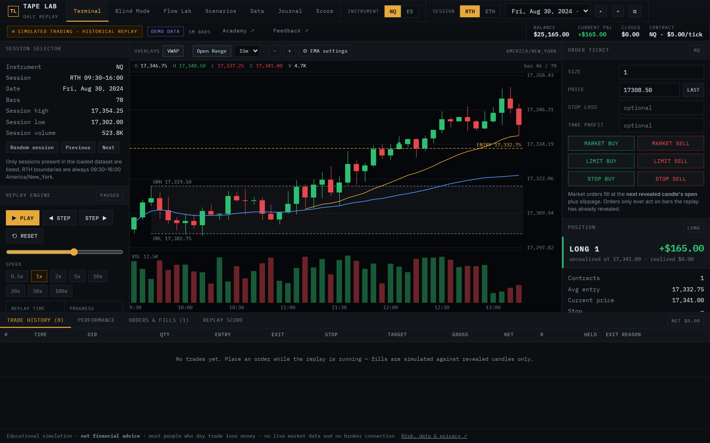
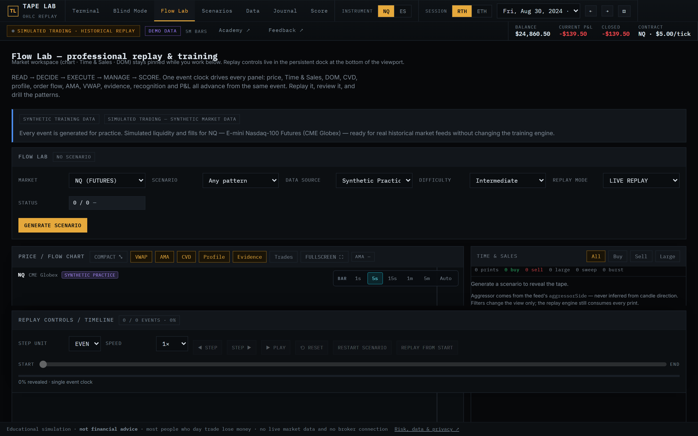
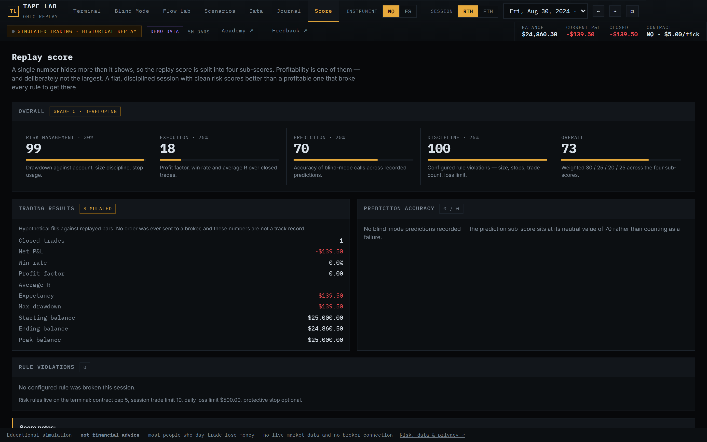
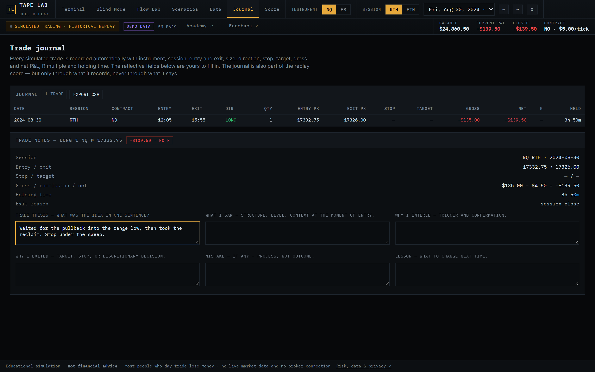
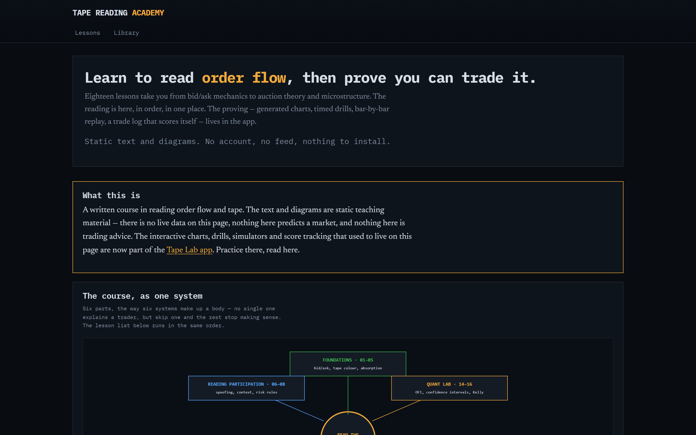

<div align="center">

# 📈 Tape Lab

**Practise reading the tape on replayed and recorded market data — with a simulated order
ticket, an order-flow lab, and a score that grades your *reads*, not your P&L.**

No signup. No broker. No live feed. Everything runs in your browser.

[](https://github.com/pavanarya24/Tape-Simulator/actions/workflows/ci.yml)
[](#quick-start)
[](#quick-start)
[](https://react.dev)
[](https://www.typescriptlang.org/)
[](https://vitejs.dev)
[](https://bun.sh)
[](#licence)

[Quick start](#quick-start) · [What's inside](#whats-inside) · [Data](#what-data-is-actually-in-it) · [Legal](public/legal.html) · [Corrections](#data-provenance--corrections)

</div>

---

> ### ⚠️ Read this first
>
> **Tape Lab is a training tool, not a trading system.** Fills are simulated with a
> documented candle-based model. **Nothing here is a broker fill.** There is **no live
> market data** and **no broker connection** — the app cannot place a real order, and it
> never asks for an account, a key, or a password.
>
> **Most people who day trade lose money.** Nothing in this repository is financial advice,
> a signal service, or a track record.

---

## Screenshots



| Flow Lab — order flow & DOM | Score — graded replay |
|---|---|
|  |  |
| **Journal** — tagged trade notes | **Academy** — the original course |
|  |  |

---

## What's inside

Seven pages, all of them practising the same skill from a different angle.

| | Page | What you do |
|---|---|---|
| 🕯️ | **Terminal** | Step through real OHLC bars one candle at a time at 0.5x–100x. The future is never revealed to the UI. Place market, limit and stop orders; set stop-loss and take-profit; flatten and reverse. |
| 🙈 | **Blind Mode** | Hide the chart and predict the next move. Your calls are recorded and scored — so you find out whether you can actually read it, or you just recognise the shape afterwards. |
| 🌊 | **Flow Lab** | Watch the tape: delta, CVD, volume-at-price, spread, microprice, aggression, and a top-10 DOM with imbalance, stacking, pulling and sweeps. Five blind scenarios (Spring, Upthrust, Absorption, Initiative Break, Responsive Fade) with the answer hidden behind *"Reveal what it was"*. |
| 🎯 | **Scenarios** | Tagged historical setups you can jump back to and replay until the read is automatic. |
| 📥 | **Data** | Import your own 5-minute NQ/ES CSVs. Parsed in the browser, stored in IndexedDB, never uploaded anywhere. |
| 📓 | **Journal** | Every simulated trade with your notes, tags and screenshots. Exports to CSV. |
| 🏅 | **Score** | A multi-factor replay score — process, risk and read quality — not just whether the trade made money. |

**Also in there:** VWAP, custom-length EMAs (any period, each with its own colour), opening
range, full performance statistics, keyboard-driven stepping, and a clear
`SIMULATED TRADING · HISTORICAL REPLAY` badge on every screen so you never forget what
you are looking at.

---

## Quick start

You need [Bun](https://bun.sh). Then:

```bash
bun install
bun run dev
```

Opening `http://localhost:5173` gives you the landing page; the terminal itself is at
`/app.html`. A clearly-labelled **synthetic demo dataset** is seeded automatically, so the
terminal works the moment it loads — you do not need to own any market data to try it.

<details>
<summary>All commands</summary>

```bash
bun run dev             # dev server (Vite)
bun run build           # production build -> dist/
bun run preview         # serve the built output
bun run typecheck       # tsc -b --noEmit
bun test tests          # unit tests
bunx playwright test    # browser tests (chromium)
bun scripts/verify.ts   # core data / replay / execution checks
```

</details>

---

## What data is actually in it

This is the part most trading apps are vague about. Here it is plainly.

| Source | What it really is | Where |
|---|---|---|
| **Synthetic demo dataset** | A seeded random walk generated in your browser. Not recorded history. | Terminal (NQ/ES sessions), seeded on first load |
| **Synthetic training feed** | A deterministic synthetic event feed — seeded trades, Level-2 snapshots, book resets. Same seed ⇒ identical events. Labelled *Synthetic Training Data* everywhere it appears. | Flow Lab |
| **Binance Spot BTCUSDT** | A genuine recorded venue capture. | Flow Lab |
| **Binance Vision historical aggTrades** | A genuine recorded venue capture. | Flow Lab |
| **Your own CSVs** | `Time, Open, High, Low, Close, Volume`. Parsed in the browser, stored in IndexedDB. Never uploaded. | Data page |

The OHLCV datasets contain **no** Time & Sales, bid/ask or Level-2 information. Flow Lab's
order-flow view is a separate engine on separate data.

> The bundled recordings are included for **individual educational use only** and are not
> licensed for redistribution. See [`LICENSE`](LICENSE) and [`THIRD-PARTY-NOTICES.md`](THIRD-PARTY-NOTICES.md).

---

## Under the hood

<details>
<summary><b>Architecture</b> — click to expand</summary>

- **Data layer** (`src/data`) — streaming CSV ingestion, OHLC validation, duplicate and gap
  detection, timeframe detection, timezone normalization (default `America/New_York`), a
  session index, and IndexedDB persistence. Only one session is ever loaded into the UI;
  the full multi-year series stays on disk.
- **Replay engine** (`src/replay`) — candle-by-candle playback with step, reset, seek and
  keyboard shortcuts. The future is never revealed to the UI.
- **Trading** (`src/orders`, `src/execution`) — market / limit / stop orders, stop-loss,
  take-profit, flatten and reverse, with a documented candle-based fill model and a
  configurable intrabar ambiguity rule.
- **Analytics** (`src/indicators`, `src/scoring`, `src/journal`, `src/scenarios`) — VWAP,
  custom-length EMAs, opening range, performance statistics, the replay score, blind-mode
  predictions, tagged scenarios and the CSV journal.
- **Future order-flow interfaces** (`src/market/types.ts`, `src/market/feed.ts`) — `Tick`,
  `Trade`, `Quote`, `OrderBookSnapshot` and `TickDataSource` are declared but intentionally
  unimplemented, so a real tick / Level-2 source can be added without redesigning the UI.
- **Flow Lab** (`src/flow`) — a vendor-neutral `MarketDataFeed` interface feeding an
  `OrderFlowEngine` (tape, delta, CVD, volume-at-price, spread, microprice, velocity,
  aggression) and a separate `DOMEngine` (top-10 book, imbalance, stacking, pulling,
  depletion, sweeps). Swapping in a real feed touches nothing below the interface.

</details>

---

## Data provenance & corrections

Kept in the README on purpose. If a claim in this project turned out to be wrong, the
correction stays visible rather than quietly disappearing.

> **Correction (2026-10).** An earlier version of this README said Flow Lab ran only on
> synthetic data. That stopped being the whole picture: Flow Lab now ships selectable
> sources — the synthetic feed described above, plus genuine recorded venue captures, each
> labelled in the app and listed with its basis in [`public/legal.html`](public/legal.html).
> Separately, the terminal's NQ/ES sessions are a seeded random walk generated in your
> browser, not recorded history. A real vendor adapter (Rithmic, …) can implement the same
> `MarketDataFeed` interface with no engine or UI changes.

> **Correction (2026-10-24).** A **Databento CME Globex NQ MBP-1 capture** was bundled into
> Flow Lab and has been **removed from the app**. A `?raw` import inlined the bytes into the
> shipped bundle, and that bundle is served to every visitor — so bundling it redistributed
> licensed CME data to the public. Flow Lab now offers the synthetic feed and two Binance
> captures. The Databento adapter (`src/flow/ingest/databento.ts`) and the on-disk fixture
> (`tests/fixtures/databento_cme_nq.jsonl`) remain for local verification; nothing served
> reaches them. The fixture is still a tracked file, so it is still published by this
> repository — removing it entirely would mean rewriting git history.

---

## Licence

**All rights reserved.** This repository is public so the work can be read and learned
from; **public availability is not a licence.** No right to copy, modify, redistribute or
reuse is granted. See [`LICENSE`](LICENSE) for the full terms, including the restrictions
on the bundled market data recordings. A permissive licence can be granted later; this
notice can be relaxed but never retroactively tightened.

- Bundled third-party code, its licences and font attributions: [`THIRD-PARTY-NOTICES.md`](THIRD-PARTY-NOTICES.md)
- Risk, data-provenance, privacy and terms of use: [`public/legal.html`](public/legal.html) — served at `/legal.html`

---

## Deployment

Vercel (or any static host) builds with `bun run build`; output directory `dist`. The
landing page is the root entry `index.html`; the app is `app.html`. `academy.html`,
`legal.html` and `shots/` are copied to the site root by Vite's `public/` directory.

---

<div align="center">

**Tape Reading Academy** — the original single-file course — is preserved unchanged at
[`/academy.html`](public/academy.html). See [`docs/COURSE_HANDOFF.md`](docs/COURSE_HANDOFF.md).

Built for practice. Not for advice.

</div>
